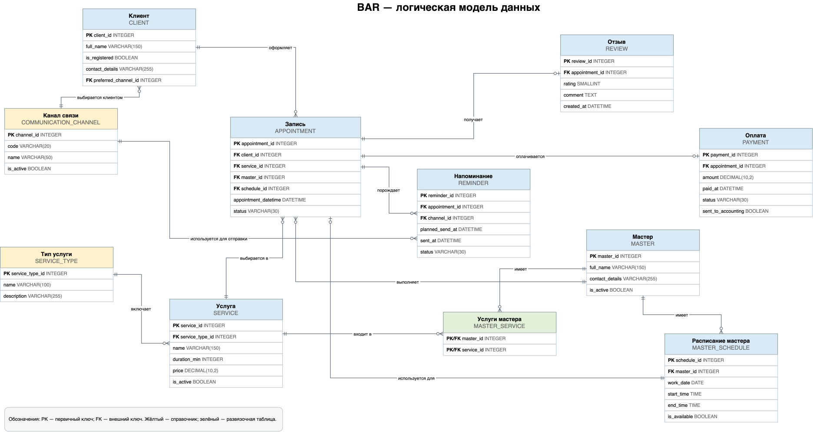
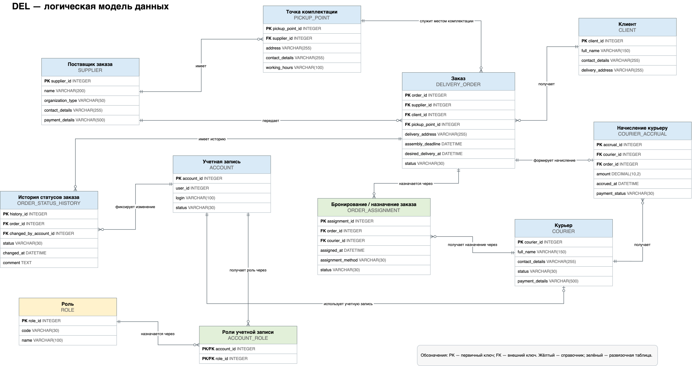

# BSA04 — Моделирование предметной области

**Школа 21 | Трек «Бизнес- и системный анализ»**

## О проекте

Учебный проект по анализу и моделированию предметной области двух информационных систем:

- **BAR** — система онлайн-записи в барбершоп.
- **DEL** — система управления доставкой заказов.

Основная работа заключалась в формализации предметных областей, выделении информационных сущностей, описании операций над данными и подготовке графических моделей.

## Выполненные работы

### 1. Выделение сущностей

Проведён анализ предметных областей BAR и DEL.

Подготовлены перечни информационных сущностей, необходимых для описания процессов записи на услуги и управления доставкой заказов.

### 2. CRUD-анализ

Для системы BAR подготовлена CRUD-матрица, отражающая операции над данными:

- **Create** — создание.
- **Read** — чтение.
- **Update** — изменение.
- **Delete** — удаление.

Матрица используется для сопоставления операций с информационными сущностями и анализа работы системы с данными.

### 3. Подготовка словарей данных

Для обеих систем подготовлены словари данных.

Документы предназначены для формализации состава данных, описания информационных сущностей и обеспечения единообразного понимания структуры информации.

### 4. Графическое моделирование

Разработаны графические модели предметных областей BAR и DEL.

Диаграммы позволяют визуализировать структуру предметных областей и взаимосвязи между информационными сущностями.

## Артефакты проекта

### Система BAR — онлайн-запись в барбершоп

| Артефакт | Файл |
|---|---|
| Перечень сущностей | [ex00_BAR_entity.xlsx](./docs/ex00_BAR_entity.xlsx) |
| CRUD-матрица | [ex01_BAR_crud.xlsx](./docs/ex01_BAR_crud.xlsx) |
| Словарь данных | [ex02_BAR_dict.xlsx](./docs/ex02_BAR_dict.xlsx) |
| Графическая модель | [ex03_BAR_model.svg](./diagrams/ex03_BAR_model.svg) |

### Система DEL — доставка заказов

| Артефакт | Файл |
|---|---|
| Перечень сущностей | [ex00_DEL_entity.xlsx](./docs/ex00_DEL_entity.xlsx) |
| Словарь данных | [ex02_DEL_dict.xlsx](./docs/ex02_DEL_dict.xlsx) |
| Графическая модель | [ex03_DEL_model.svg](./diagrams/ex03_DEL_model.svg) |

## Графические модели

### BAR — система онлайн-записи

### DEL — система доставки заказов

## Методы и компетенции

- Анализ предметной области (Domain Analysis).
- Моделирование информационных сущностей.
- Определение связей между сущностями.
- CRUD-анализ.
- Подготовка словарей данных.
- Графическое моделирование.
- Структурирование аналитической документации.

## Результат

Подготовлен комплект аналитических артефактов для описания предметных областей двух информационных систем.

Получена практика моделирования данных, формализации структуры информации и подготовки документации, используемой на этапе проектирования информационных систем.

---

*Учебный проект. Исходные тексты заданий не публикуются.*
